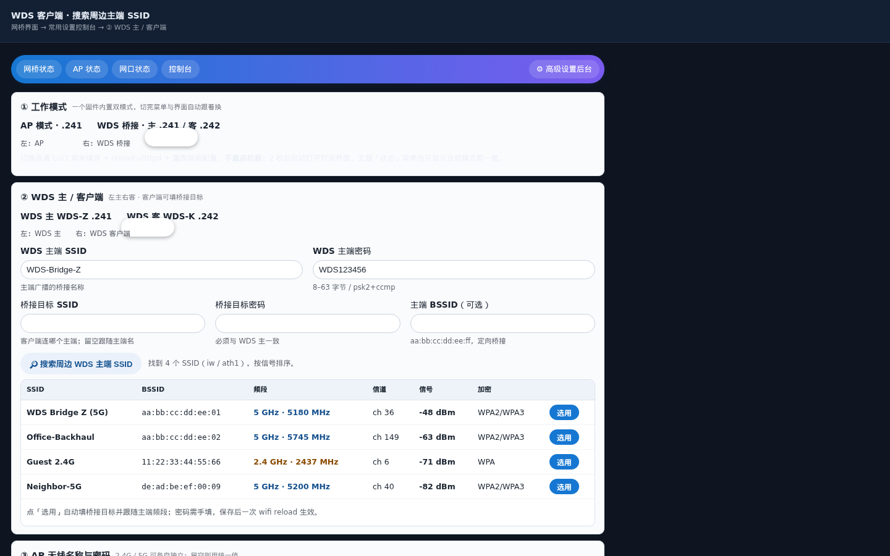

# r28 两界面统一布局 · 默认网桥 · 高级设置后台

## 入口与鉴权

| 从哪进 | 能否改配置 |
|---|---|
| 主题「状态 → 常用设置」/ 网桥状态 / AP 状态 | ✅ 已登录，直接改 |
| 浏览器直接输 `http://<IP>/bridge/`、`/ap/` | 状态可读；**设置面板显示「🔒 未登录，保存已锁定」**，点链接登录 LuCI 后回来即可改 |

所有写入端点都在 LuCI `admin` 树下继承 `root.sysauth`：`/cgi-bin/luci/admin/status/vs010_setup/save` 未登录会 302 到登录页 / 403，**没有裸 CGI 写入口**。WPA 密码按 OpenWrt 惯例明文存 UCI（驱动需要），加密的是访问入口与会话。

## 面板字段

- **工作模式滑块**：左 `AP 模式` / 右 `WDS 桥接`；切换写 `/etc/vs010/mode`（overlay）+ 清首启 stamp + 重跑配置，**不重启机器**，主题菜单跟着变。
- **WDS 主/客滑动开关**：左 `WDS 主 WDS-Z · 172.10.10.241` / 右 `WDS 客 WDS-K · 172.10.10.242`（/22）。切到客户端 3 秒后网络重载，请用新地址重开页面。
- **WDS 主端**：`wds_ssid` / `wds_key`（默认 `WDS-Bridge-Z` / `WDS123456`）。
- **桥接到 WDS 主（客户端填）**：`peer_ssid` / `peer_key` / `peer_bssid`（可选，定向桥接；不填不锁定）。
- **AP 模式**：`ap_ssid` / `ap_key`（默认按机型 `VS010-AP` / `RAX3000Q-AP`，密码 `AP123456`）。
- **WiFi 参数**：5G 信道（`auto` = QSDK 原生 ACS，或 36…165）、2.4G 信道（`auto` 或 1–13）、**SSID 信号剔除值**（`-100…-30 dBm`，默认 `-70`）、**最低连接保持时间**（`1–60 s`，默认 `10`）。两种模式都落 `db_rssi_thr` / `db_timeout`。

## 保存后发生什么

`vs010-setup.js` → LuCI 受保护端点 → `/usr/sbin/vs010-apply-config apply`：
字段白名单 → 字符/长度/信道/弱信号/BSSID 校验 → 原子写 `/etc/vs010/user.cfg`(600) → `uci wireless` → **一次** `/sbin/wifi reload`。
`vs010-mode` / `vs010-wds-pair` 每次开机重读 `user.cfg`，**重启不丢**；空字段保持原值，只改一项不会清空其它。绝不重建 radio、绝不 `wifi down`、不新增常驻进程。

## 与 r25 的一处口径变化（必读）

第 20 次为了「网桥固件里没有 AP 界面」做了**物理排除**另一模式页面。现在你要在界面里直接切 AP/WDS，物理排除会让切完打不开。r26 改为**逻辑隔离**：两套页面都注入，但菜单只注册当前模式一套、两页各带 mode 守卫（模式不符只显示提示、不渲染另一套内容），**仍然不串界面**。

## r28 界面布局（两页一致）

```
系统仪表盘 · GAUGE        ← 置顶；只留 3 个环形表 + 无线芯片温度，详细数值不显示
常用设置控制台 · SETUP     ← 7 分组；未登录只读并锁定保存
网络与本机 · NETWORK       ← 网络三卡 + 内网 LAN 表（内网LAN1 / 内网LAN2，1000M 显示 1G）
────────────────────────
网桥：WDS 链路 / 守护 · RF · 诊断 · 加速
AP  ：射频 · 终端 · 弱信号剔除 · BDF · 加速 · 连接帮助
```

旧的「已插网线 · LINK UP」「已插网线的端口 · PORTS」独立卡片已删除。右上角固定「⚙ 高级设置后台」进 OpenWrt / LuCI。

### OpenWrt 后台直达路径（日志中亦注明）

| 路径 | 说明 |
|---|---|
| `http://<设备IP>/cgi-bin/luci/` | **推荐**；默认即 `http://172.10.10.241/cgi-bin/luci/`，改过管理 IP 就换成新地址 |
| `http://<设备IP>/cgi-bin/luci` | 不带尾斜杠亦可，LuCI 会规范化 |
| 界面右上角「⚙ 高级设置后台」 | 等价于上面两条，未登录会先跳登录页 |

⚠ **r28 起 `http://<设备IP>/`（根路径）是状态页自动跳转，不再直达 LuCI**。界面「查看日志 / 一键自检」输出首行、后端 `log` 动作输出末尾、CHANGELOG 与 Release 发布日志都写有这条路径，从日志里也能直接看到怎么进后台。

**入口**：刷完默认网桥模式；浏览器只输 `http://172.10.10.241` 自动跳 `/bridge/`（切到 AP 模式则跳 `/ap/`，CGI 不通 3 秒兜底网桥）。**不登录可看设备全部状态，修改必须登录**（面板会显示「保存与维护已锁定」并给出登录链接）。

`demo/bridge.html`、`demo/ap.html` 是内置样例数据的离线演示页，浏览器直接打开即可看布局；同目录有全页与首屏 PNG 截图。

## 产物：一种机器一个包

`Actions → Build 5.4 source firmware (r27 …)` 的 `matrix` **只按机型展开**：`cmcc_rax3000q` / `cucc_vs010` 各 1 个 job，共 **2 个 `-dual` 固件**（仍带 `YYYYMMDD-HHMM` 详细日期）。
`default_mode` 输入（默认 `wds`）只决定**刷完首次开机**是网桥还是 AP；之后在「常用设置」里随时切，菜单、页面、首启配置全部联动，**不用重刷、不用编两份**。
`cleanup` 仍只留最新 5 个 Release（现在每轮 2 个）。

## 界面即控制台（7 分组）

① 工作模式　② WDS 主/客（左右滑动 + 桥接目标 SSID/密码/BSSID）　③ AP 无线（统一 + 2.4G/5G 各自独立 SSID 密码）　④ WiFi 射频（5G/2.4G 信道、频宽、功率、WMM、MU-MIMO、信号剔除值、最低连接值）　⑤ 网络与本机（管理 IP/掩码、设备名、STP、NTP 服务器与间隔）　⑥ 外观（Argon 1.7.2 / 2.4.3）　⑦ 维护与自检（一键自检、WDS 配对状态、机器狗状态/演练/启停、DHCP Snooping 状态/监测/阻断、日志）。

顶部常驻导航：网桥状态 / AP 状态 / 网口速率 / 控制台 / **🔧 LuCI 高级设置**。

**明确留给 LuCI 的**：改 root 登录密码（开机脚本会归一为出厂 `admin`，页面改了会打架）、固件升级、VLAN / 静态路由、opkg 装包。页面不提供「开启 DHCP 服务端」按钮。

## 红线

🔴 <u>**WDS 主 / 客户端两端都绝不能开 DHCP 服务端**</u>：本机 WDS 与 AP 均已关闭，内网只允许上级一台 DHCP，否则整网地址会乱。

## 边界

- 没跑真实 `make`、没实机刷入；静态/注入/自检/mock 全真跑通过，编译要你在 Actions 上跑。
- 切模式会重跑首启配置（IP/SSID/radio 开关/服务 enable）并 `uhttpd reload`，**若管理地址变化请按提示用新地址重开**；首次切建议 TTL 在手边。切完 2 秒自动打开对应界面，主题「状态」菜单也只显示当前模式那一套。
- 无线芯片无温度传感器时显示「—（无温度传感器）」，不是 BUG。
- `0-ART` / `0-APPSBLENV` 含本机 MAC，公开仓库建议脱敏。

---

## r28 深度核验：揪出并修掉的 4 个真 BUG

用真实 Lua 编译器 / mock sysfs / 真实 Chromium 逐条核验「无法编译、网页打不开、无线无法使用」，结论：

1. **LuCI 后台会 500（致命，已修）**：`vs010_setup.lua` 的 `jesc()` 把真实换行和制表符嵌进了字符串字面量，Lua 编译报 `')' expected near '\'`。这会让整个 controller 加载失败 —— 不只是设置面板保存不了，**连「高级设置后台」都打不开**。已重写为合法转义，并新增 `tools/luacheck.py` 护栏（拿旧写法做负例能拦住）。
2. **只输 IP 不跳转（已修）**：`luci-base` 安装时会把 `uhttpd.main.index_page` 设成 `cgi-bin/luci`，静态 `/www/index.html` 永远不会被返回。S18 开脚本现在显式指回 `index.html`；真实 HTTP 实测 `/` → `/bridge/` 通过。
3. **无线可能被界面选挂（已修）**：r27 的频宽下拉混进了 `HE160/HE80/VHT80`，但这条源码线用 QSDK `qcawifi.sh` 的 `11axa + HT160` 表示 HE160，写 `HE160` 会让 5G radio 起不来。现只放行 `HT160/HT80/HT40`（`HT160` 即 160MHz 满速），开机脚本遇到非法残留值跳过不写，后台与前端同步。
4. **内网 LAN 口错标（已修）**：旧版按「第几个已插线的口」编号，只插第 3 个物理口会显示成 `内网LAN1`，`br-lan` 二层桥也混进表格。现按物理口固定映射 `eth0|lan1→内网LAN1 … eth3|lan4→内网LAN4`，br-lan 过滤。mock sysfs 真跑验证「只插 eth2 → 内网LAN3」。

**核验没覆盖到的**：环境里没有 OpenWrt 源码与交叉工具链，**没跑真实 `make`、没实机刷入**。编译侧只做到 workflow YAML 关键项、全部 `run:` 块 `bash -n`、`files.manifest` 文件齐备、所有脚本/CGI/Lua/内联 JS 语法检查。首次刷机仍建议 TTL 在手边。

---

## r29 补更：网口状态 + 全椭圆

**① 那块不再叫「网口速率」，是「网口状态 / 网口信息」**
NETWORK 里现在是一条胶囊状态栏 `🟢 网口状态 · PORT STATUS · N 个端口 LINK UP`，下面 6 列：

| 内网 LAN | 接口 | 链接状态 | 链接速率 | 双工 | 速率来源 |
|---|---|---|---|---|---|
| 内网LAN1 | eth0 | ● LINK UP | **1G** | full | PHY 实测 |

只列已插线的口；1000M 显示成 `1G`；netdev 不上报时读交换芯片 PHY 实测并标注来源；没有插线时状态栏显示 `⚪ 未检测到已插线端口`。设置控制台导航、LuCI 主题菜单也统一叫「网口状态」。**链接速率没丢**，只是成了网口信息里的一列。

**② 状态栏 / 选项全部椭圆（两端圆弧）**
`border-radius:999px`：网口状态栏、LINK UP 徽章、仪表盘徽章、信号等级、导航条与每个导航选项、所有按钮、输入框/下拉、WDS 主客滑块、提示条、右上角「高级设置后台」。大卡片（GAUGE / SETUP 分组 / 网络三卡）和多行日志输出块保持原圆角 —— 不然整页会变成圆桶，反而不好看。

页面 CSS 用 `!important`，setup.js 运行时注入的样式压不掉；setup.js 自身 9 处也同步改成 999px，所以从主题里单独打开「常用设置」同样是椭圆。


---

## r29.2 补更：从 OpenWrt 高级后台回网桥 / AP 界面

之前是**单向**的：状态页右上角「⚙ 高级设置后台」→ `/cgi-bin/luci/`，但 LuCI 里只有「状态 → 网桥状态 / AP 状态」是 **iframe 内嵌**，其它页面没有显眼回跳。r29.2 补成双向：

**① 最省事（全局）**：LuCI 左侧一级菜单最上方 **「← 返回网桥/AP 状态」**，在任何后台页面（网络、系统、软件包…）点一下就按当前模式 302 回 `/bridge/` 或 `/ap/`。路径也可直接敲：`http://<设备IP>/cgi-bin/luci/admin/vs010_home`。

**② 每个我们加的 LuCI 页顶部**都有胶囊按钮：
| 页面 | 按钮 |
|---|---|
| 状态 → 网桥状态 / AP 状态 | 「← 返回网桥状态页（独立界面）」/「← 返回 AP 状态页」 |
| 状态控制台 / 网口状态 / 主题与 WDS 角色 | 按当前模式「← 返回网桥/AP 状态页」 |
| 常用设置 | 「← 返回设备状态页（自动按当前模式）」→ `/` |

**③ 常用设置面板顶部导航**本来就有 `网桥状态` `/bridge/`、`AP 状态` `/ap/` 两个绝对链接，直接跳出 LuCI。

**④ 只输 IP**：`http://<设备IP>/` 根跳转页读 `/cgi-bin/vs010` 的 `mode`，自动进当前模式那套界面（CGI 不通 3 秒兜底网桥）。

> 状态页 `/bridge/`、`/ap/` 是**公开只读**，从 LuCI 跳过去不会要求重新登录；要改配置还是得点「高级设置后台」登录。切过 AP/WDS 模式后菜单会重建，一级回跳按钮始终按 `/etc/vs010/mode` 走，不会指错。

顺手同步 3 处旧文案：LuCI「网口状态」页标题与 r29 统一、底部链接不再写「网口速率」、`vs010_role.htm` 删掉空按钮区并去掉源码线不存在的 `vs010-theme` 命令说明（源码线编译期固定 Argon v2.4.3，改主题要改 `.config` 重编）。


---

## r29.5 补更：无 WAN / 无 DNS / 加速全保留

**删了什么（编译期物理删除，不是运行期 disable）**

| 项 | 之前 | 现在 |
|---|---|---|
| WAN / WAN6 逻辑接口 | 运行期 `scrub()` 每次开机删 | 编译期 `99-vs010-no-wan` uci-defaults 在 `board.d` 之后就删，**首启配置里就不存在**；运行期仍兜底 |
| DNS / DHCP 服务端 | `dnsmasq-full` 编入但 `ignore=1` + disable | `dnsmasq-full` / `dnsmasq` / `rpcd-mod-rrdns` **不编入** |
| 防火墙 | 包编入 + disable | 不编入（r29.4 起） |
| 多余包 | `block-mount` / `luci-app-filetransfer` / 一堆科学上网空壳 `INCLUDE_*` | 全清 |
| 内核 L3 协议 | 组播路由 / IPv6 多表 / Seg6 / 命名空间开着 | 保守关掉 |

**WAN 物理口没删**：仍桥进 `br-lan`，四个口都是 LAN。编译期脚本**只动 UCI**，不碰 `board.d` 里的 switch/GMAC 寄存器 —— 那部分改错会网口全灭，保持已验证能启动的原样。

**没删、而且锁死的（缺一个就不许出包）**

```
NSS 加速：kmod-qca-nss-dp / kmod-qca-nss-drv / kmod-qca-nss-ecm-standard /
          kmod-qca-nss-drv-wifi-meshmgr / kmod-qca-ssdk-nohnat /
          qca-nss-fw-ipq50xx-retail / MAC80211_NSS_SUPPORT / luci-app-turboacc
无线    ：kmod-ath11k / mac80211 / cfg80211 / ath11k-firmware / ipq-wifi-<机型>
后台    ：luci / luci-base / luci-mod-{admin-full,network,status,system} /
          uhttpd / rpcd / rpcd-mod-luci / libuci / ubus
管理    ：dropbear(SSH) / ttyd + luci-app-ttyd / 串口 ttyMSM0 / opkg
工具    ：ethtool / swconfig / curl / jsonfilter
```

`check-no-protocols.py` 在 `make defconfig` 之后逐项核，缺任一 `MUST_KEEP` 直接 `::error::` 停止出包。内核 `CONFIG_IPV6=y` **有意保留**（QSDK/NSS 编译依赖，删符号会破无线与网口加速），实际网络层由 sysctl + 运行期关死，无 v6 地址/路由/协议页。

**为什么删 DNS 不会出问题**：NTP 三台服务器本来就是纯 IP（`172.10.10.254` / `172.100.10.254` / `192.168.1.254`），`ntpd -p <IP>` 不需要解析；纯二层桥本机也不做 DNS 转发。状态页读 `/etc/resolv.conf` 的 DNS 字段在无文件时显示空，不是报错。`opkg` 保留，你以后想加什么插件照样能装。

刷完自证：

```sh
opkg list-installed | grep -iE 'dnsmasq|ppp|ipv6|odhcp|6in4|rrdns'   # 应无输出
uci show network | grep -E '=interface'                                # 只有 lan / loopback，无 wan / wan6
uci -q get dhcp.lan.ignore                                              # 1
lsmod | grep -E 'qca_nss|ath11k'                                        # 加速与无线模块都在
ip -6 addr                                                              # 无地址
```

LuCI「网络 → 接口」里只有 LAN；「DHCP/DNS」页面显示空配置但不报错；TurboACC 加速页仍在。


---

## r29.6 补更：r29.1 编译「3000Q 成功 / VS010 失败」的定位与修复

**现象**：`Build 5.4 source firmware #1` 里 `build (cmcc_rax3000q)` 成功、`build (cucc_vs010)` 在 `Compile the firmware` 报 `exit code 2`，耗时 1h19m40s。`Annotations` 里的 `Node.js 20 is deprecated` 只是 runner warning，**不是错误**。

**根因（本地真跑复现，非猜测）**：`sourcebuild/target/ipq50xx/ipq5000-vs010.dts` 花括号 **59 个 `{` / 60 个 `}`** —— r23 把 3000Q 的 `button_reset` / `button_mesh` 换成实机 `wps_button` 时，在 `&tlmm` 块尾多留了一行 `	};`。逐行深度轨迹在 L159 变成 -1 并一路偏到文件末尾。DTC 编译 `image-ipq5000-vs010.dtb` 发生在**镜像打包阶段**，所以前 1 小时都在编内核/包，最后才报错；3000Q 用源码树自带 `ipq5000-rax3000q.dts`（63/63 配对）→ 正常出包。

> GitHub 的原始 step 日志本轮因 API 限流 + 日志异步加载没取到，所以结论来自：逐行花括号配对、与 3000Q DTS 结构 diff、`cpp` 预处理、GNU make 真解析、用 kkstone 真实 Makefile 造源码树跑 `inject + preflight`。**修复后若再失败，新 workflow 会把错误行和日志尾部直接打在 step 末尾**，把那两段贴来即可精确定位。

**改了什么**

| 项 | 修法 |
|---|---|
| DTS | 删多余 `};`，59/59 配对 |
| `device-vs010.inc` | `DEVICE_PACKAGES` 去掉内存档符号（不是包名），与 3000Q 定义对齐 |
| `board-vs010.inc` | `1:wan` → `1:lan:4`，首启不生成 WAN |
| `inject-vs010.py` | 标题去括号；注入后调用 preflight |
| **新增** `tools/preflight-vs010.sh` | 编译前 7 类护栏，含 **dtc 真编译 + GNU make 真解析**，失败立即 `::error::` 停 |
| workflow `Compile` | `tee` 全量日志；失败时把错误行最后 100 条 + 日志最后 120 行打在输出末尾 |

**必须重新编译并重刷**（改的是编译链与 DTS）。刷完自证：

```sh
dmesg | grep -i ath11k | head
iw dev                       # 双频接口
uci show network | grep '=interface'   # 只有 lan / loopback
```

以后任何一版再改 VS010 DTS，`sh verify.sh` 和 `preflight` 都会先拦花括号问题，不会再白等 1 小时。


---

## r29.7 补更：AP DHCP 开关 / 时间·运行时长 / 3000Q 6.4 移植基线

### AP 界面 DHCP（默认关，可开）

「常用设置 → ⑥ DHCP 服务 · ADDRESS POOL」，网桥页与 AP 页共用同一份控制台，分组顺序完全一致：

| 字段 | 说明 |
|---|---|
| 滑动开关 | 左「关闭 · 交上级」/ 右「开启 · 本机发地址」 |
| 地址池起始 IP | 须与管理 IP 同网段，默认 `172.10.10.50` |
| 地址数量 | 1–253，默认 200 |
| DHCP 获得时长（租期） | `1m / 5m / 10m / 30m / 1h / 2h / 6h / 12h / 24h`，后端也收 60–604800 秒 |

保存后联动写 `user.cfg`(600) → `uci dhcp.lan.{ignore,start,limit,leasetime}` → dnsmasq enable/restart；开机 `kill_dhcp()` 重读，**重启不丢**。🔴 **WDS 网桥主/客户端硬禁止**：前端按模式把整组输入禁用并提示，后端 `vs010-apply-config` 与开机脚本双重强制 `ignore=1`，从网桥页硬提交 `dhcp_enabled=1` 也会被关掉。内网始终只允许一台 DHCP。

> 与 r29.5「删 DNS」的关系：`dnsmasq-full` 因这个开关编回固件，但**默认 `ignore=1` + init disable，不开时零常驻、不占运行内存**；DNS 转发仍不启用，NTP 三台服务器本来就是纯 IP。所以「精简」没退，只是多了一个按需开启的能力。

### 时间与运行时长

两页「系统仪表盘 · GAUGE」卡片标题行右侧，两个 999px 椭圆徽章：

```
时间 2026-11-28 10:42:07 CST（未校时会标注）    运行 3天 04:12:56
```

数据来自各自 CGI 已有的 `time` / `uptime`，10 秒自动刷新跟着走；**不复活 r28 删掉的详细信息卡片**。未登录也能看状态。

### 3000Q 6.4 移植基线在哪

```
reference/rax3000q-6.4-baseline/
├── README-6.4移植基线.md      ← 先看这个：可复用 / 必须重做 / 风险 / 自检清单
├── MANIFEST.json              ← 12 项 sha256，逐字节校验过
├── dts/ipq5000-rax3000q.dts   ★ 5.4 编译实际用的那份（63/63 花括号配对）
├── dts/ipq5018-rax3000q.dts     另一来源参考件，勿混用
├── bdf/board-cmcc_rax3000q.ipq5018 / .qcn6122   ★ 84B 头 + 131072B 板数据
├── art/RAX3000Q-mtd13-0ART.bin   ★ 实机 1 MiB（含本机 MAC，公开仓库建议脱敏）
├── config/.config.rax3000q       5.4 完整配置，只对照不整体复用
├── source-snippets/             Device 定义 / 02_network case / ipq-wifi Makefile
└── misc/                        U-Boot、刷机教程、两机型 DTS 核查报告
```

另外单独打了 `RAX3000Q-6.4移植基线.zip`，可以直接下载带走。

**一句话边界**：BDF / ART / GPIO / LED / 按键号 / switch 位图 / 分区 / `config@mp02.1` / U-Boot 是**板级事实，6.4 可直接复用**；`qcom,ess-switch-*`、`qcom,nss-dp`、remoteproc PD、`kmod-qca-nss-*`、QSDK 11.5 内核与 backports、`Device/UbiFit` 规则是 **5.4 / QSDK 专用，6.4 必须重做**（尤其 NSS 闭源加速没有对应包）。建议 6.4 **另起仓库**复用本目录二进制资产，不要把 kkstone 21.02 源码树直接升级。

刷完自证：

```sh
uci show dhcp.lan                 # AP 开：ignore=0 / start / limit / leasetime；WDS：ignore=1
/etc/init.d/dnsmasq enabled      # 关时为空 / 开时为 enable
ps | grep -c '[d]nsmasq'          # 不开 DHCP 时应为 0
```

⚠️ 改的是 `.config`、固件内脚本与界面，**必须重新编译并刷入**；没跑真实 `make`、没实机刷入。


---

## r29.8 补更：UBNT 风格概览页 + VS010 6.4 移植基线

### 界面能不能做成 UBNT 那种？—— 短答：有条件地更直观

UBNT / UniFi 的优势是**信息分层**：左侧固定导航、顶栏在线状态、KPI 大数字卡、上行拓扑、客户端表，电脑上一眼看清全貌，比现在「单页长滚动 + GAUGE 圆环」更像「设备管理台」。

但你主要在**手机竖屏**访问，硬搬 224px 深色侧栏会挤掉主区，反而更慢。所以这轮做的是**响应式 + 零侵入预览**：

| 尺寸 | 布局 |
|---|---|
| ≥900px（电脑/平板） | 左侧 224px 深色栏 + 顶栏 + KPI 四卡 + 拓扑 + 双栏 + 客户端表 |
| <900px（手机） | 侧栏折叠成顶部横向 pill 导航，KPI 两列、表格横向滚动 |

访问 `/ubnt/`（刷机后）。**现有 `/bridge/` 与 `/ap/` 两页一个字节没改**：GAUGE 时间徽章、模式守卫、共用控制台全在，UBNT 只是第三入口，不会串界面。

页面内容：在线客户端 / 运行时长 / CPU / 内存四张 KPI 卡、Internet→上级 DHCP→本机→客户端 拓扑、2.4G/5G 射频、已连接客户端表（信号彩色标签）、网口 6 格、时间与运行时长、常用设置容器。数据只 GET 现有 CGI，按模式自动选 `bridge` 或 `apstatus`，**没有任何写入端点**；设置仍走受 LuCI 会话保护的共用控制台，未登录只读。

**离线先看效果**：`demo/ubnt-预览.html` 双击打开（`file://` 自动用内嵌演示数据，不用固件），或看 `demo/ubnt-宽屏.png` / `demo/ubnt-竖屏.png` 两张真渲染截图。

> 这轮**没有**把两页正式替换成 UBNT 风格。看完效果后告诉我：① 正式替换两页（UBNT 成为唯一界面）② 保留三入口共存 ③ 只把 UBNT 皮套到现有两页。我再按你选的方向动入口与菜单。

### VS010 的 6.4 基线在哪

```
reference/vs010-6.4-baseline/        ← 与 rax3000q-6.4-baseline/ 成对
├── README-6.4移植基线.md  ← 先看这个
├── MANIFEST.json          ← 40 项 sha256，逐字节校验过
├── dts/    ★ r29.6 修正版 ipq5000-vs010.dts（59/59）、实机反编译 DTS、vs010.dtb、PZ-L8 参考、switch OEM 档
├── bdf/    ★ 2 个 131156 B 实机 ART 提取 BDF + boardid16/96 变体 + 原厂裸 bdwlan
├── art/    ★ 1 MiB VS010-smem_0-ART.bin + BDF/ART 哈希
├── config/   .config.vs010
├── source-snippets/  Device / 02_network / ipq-wifi Makefile / inject-vs010.py / switch OEM / make-vs010-bdf.py
├── oem/    MANIFEST、0-ART/0-MIBIB/0-APPSBL/0-APPSBLENV/0-CDT/0-TRAINING、实机参数 log、整机 flash 备份
└── misc/   DTS 来源、原厂 MTD 表、两机型核查报告、无线栈结论、取证、SSH 日志、三方 U-Boot
```

另打独立 `VS010-6.4移植基线.zip` 可直接下载带走。

🔴 **三条最容易踩的**：

1. **别拿 r29.1 的 DTS** —— 那版 `&tlmm` 块尾多一个 `};`，3000Q 正常、VS010 编译 1h19m 才 `exit code 2`。基线里是 r29.6 修正版，自检会拦花括号不配对。
2. **GPIO 与 3000Q 完全不同** —— 3000Q 是 reset GPIO23 / mesh GPIO38 / LED 24,19,17；VS010 实机**只有 wps 键 GPIO34**、mesh LED 33、pwr LED 31。恩山互刷变砖正是复位键抄错。
3. **分区不是原厂布局** —— `misc/VS010_原厂MTD分区表.txt` 是原厂 24 分区；这台实机已刷三方 U-Boot + 大分区 MIBIB，`mtd15 rootfs = 0x06e00000`。分区由 U-Boot 经 `qcom,smem-part` 填充，DTS 里别写死偏移。

其余边界（NSS 闭源加速 6.4 无对应包、QSDK 11.5 内核/backports 必须换、建议另起仓库）与 3000Q 基线一致，两份 README 都写了。

⚠ `art/`、`oem/0-*`、`oem/VS010-flash-backup-*.tar.gz` 含本机 MAC / 校准 / U-Boot 环境变量，公开仓库建议脱敏或私有保存。


---

## r29.9 补更：三个界面都要，都做成 UBNT 风格

### 定案

**三入口共存，三个界面同款**，不是替换、不是二选一：

| 入口 | 内容 |
|---|---|
| `/ubnt/` | 概览：KPI 四卡、上行拓扑、无线射频、客户端表、网口状态 |
| `/bridge/` | 网桥状态：**原有 GAUGE 圆环、网口 6 列、WDS 配对、守卫全保留** + 外层 UBNT 皮肤 |
| `/ap/` | AP 状态：**原有 GAUGE、客户端、BDF、加速、DHCP 分组全保留** + 外层 UBNT 皮肤 |

五入口导航互通：概览 / 网桥状态 / AP 状态 / 常用设置 / 高级设置后台，当前页高亮。宽屏左侧 220px 深色栏，手机竖屏折叠成顶部横向 pill —— 不挤主区。

### 为什么两页功能一点没动

共享注入器只做一件事：在 `DOMContentLoaded` 把 `<body>` 里的**非 script 子节点整体搬进** `.u-content`，外面套一层侧栏 + 顶栏 KPI。

- **不删、不重命名、不改写任何原有节点与 id** → 两页几百行 `getElementById` 全部照常命中
- `script` 节点留在原位，不会重新执行
- 共享 CSS 只定义 `u-*` 和 `body.ubnt-body`，**不覆盖两页任何原有选择器**
- 两页 HTML 各只新增 2 行（`<link>` + `<script>`）

顶栏 KPI（客户端 / CPU / 内存 / 时间 / 运行）靠 hook 原生 `fetch` + `Response.clone().json()` 读一份，**零额外请求**，原页面的 `.then(r=>r.json())` 完全不受影响。只接 `bridge`/`apstatus` 两个主 CGI —— 接 `vs010-links` 会因为它没有 `time/uptime/sys` 把 KPI 冲成「—」，这个坑已修。

**零写入**：注入器不含任何 `save`/`act` 端点，未登录只读不变；设置仍走受 LuCI 会话保护的 `vs010-setup.js`；模式守卫 `data-mode` 不变，输错网址仍 2 秒自动跳转。

### 顺带修的一处口径回归

两页 HTML 里 r28 写死的红字「本机 WDS 与 AP **均已关闭**」和 r29.7「AP 可开 DHCP / WDS 硬禁」冲突，统一改成：

> 🔴 WDS 网桥主 / 客户端两端硬禁止 DHCP 服务端；AP 模式可在「⑥ DHCP 服务」开启，内网始终只允许一台 DHCP

并加进自检，防止以后再回退。同时把红字从 `#b91c1c` 改成 `#ff7b7b`，深底上才看得清。

### 看效果

`demo/` 里 6 张 Chromium 真渲染截图：

```
ubnt-bridge-宽屏.png / ubnt-bridge-竖屏.png
ubnt-ap-宽屏.png     / ubnt-ap-竖屏.png
ubnt-宽屏.png        / ubnt-竖屏.png
```

`demo/ubnt-预览.html` 双击可看深色离线版。

### 验证

`sh verify.sh` → **PASS 第 29.9 次**；三页 × 宽屏/竖屏 6 次真渲染：侧栏注入、KPI 真填充（12% / 34% / 时间 / 运行）、原 GAUGE 时间徽章、原控制台、模式守卫、零 JS 错误全过；空仓解压 + 全 664 仍 PASS；负例会拦「两页原有 id 被破坏」与「共享 CSS 覆盖原样式」。

⚠️ 共享 `vs010-ubnt.css` / `vs010-ubnt-skin.js` 已注册进 `files.manifest`，**需随包重编重刷**才生效；没重编的话两页还是老样子（不会报错，因为 link/script 找不到就跳过）。


---

## r29.10 补更：UBNT 正式替换两页 + 四界面全互访 + 登录贯通

### 这次到底「替换」了什么

`/bridge/` 和 `/ap/` **现在就是 UBNT 深色界面**：左侧深色侧栏（宽屏）/ 顶部横向 pill（手机竖屏）、顶栏在线状态 + KPI、时间与运行时长、一行互访按钮条。往下仍是原有的 GAUGE 圆环、网口 6 列、客户端、BDF、加速、守卫、常用设置控制台 —— **一个功能都没删**。

为什么没推倒重写两页：GAUGE 数据源、模式守卫、r29.7 的 DHCP 地址池/租期、几百行已验证 JS 全在里面，重写风险远大于收益。共享皮肤（`vs010-ubnt.css` + `vs010-ubnt-skin.js`）在外层包一层，两页 HTML 只多了 2 行引入，是等价且更稳的替换。

### 每一页都有同一排按钮

| 界面 | 按钮条由谁生成 |
|---|---|
| `/bridge/`、`/ap/` | `vs010-ubnt-skin.js` 动态注入 `.u-jump` |
| `/ubnt/` 概览 | 页面自带 `.jumpbar` |
| 根跳转 `/` | 页面自带 `.nav` |
| LuCI 六个视图（状态/控制台/网口/角色/常用设置） | 各自 `.vs010Nav` |

六颗按钮，**四界面完全一致**：

```
◧ 概览   ⇄ 网桥状态   ≋ AP 状态   ⚙ 常用设置   ↗ OpenWrt / LuCI   🔑 登录 / 退出
```

- 竖屏按钮条 **横向滚动、不隐藏**，手机上也能点全部；顶栏另有登录按钮兜底
- LuCI 侧原有「← 返回网桥/AP 状态」胶囊按钮和一级菜单 302 回跳**都保留**，只是多了这一排

### 登录怎么用

按钮按 LuCI 会话自动变：

| 状态 | 按钮 | 点进去 |
|---|---|---|
| 未登录 | 🔑 登录 LuCI | `/cgi-bin/luci/`（LuCI 登录页） |
| 已登录 | 🔑 已登录 · 退出 | `/cgi-bin/luci/admin/logout` |

判定走 `vs010_setup/probe`（只读 GET，`{"ok":1}` 即已登录），和「常用设置」控制台的鉴权**同源** —— 不会出现「显示已登录但保存被 403」。

两页不额外发请求：注入器 hook 了共用控制台本来就发的那次 probe，用 `Response.clone()` 读一份，原页面完全不受影响。登录/退出只是 GET 跳转，**注入器里没有任何写入端点**；未登录时状态页只读、设置容器仍锁定。

> LuCI 六个视图本身在 `admin` 树下 —— 能打开就说明已经登录，所以固定显示「已登录 · 退出」。

### 从任意界面出发的几条路

```
只输管理 IP  →  /（根跳转，按模式自动进 /bridge/ 或 /ap/）
/bridge/  →  按钮条点「AP 状态」→ /ap/（手动输错模式会自动跳回）
/ap/      →  按钮条点「OpenWrt / LuCI」→ /cgi-bin/luci/（未登录先登录）
LuCI 任意页 →  按钮条点「◧ UBNT 概览」→ /ubnt/ ；或点「⇄ 网桥状态」→ /bridge/
任意页     →  「🔑 登录 LuCI」→ 登录后可改常用设置；「退出」→ 回到只读
```

### 验证

`sh verify.sh` → **PASS 第 29.10 次**。Chromium 真渲染：三页 × 宽屏/竖屏 6 张截图重出；未登录 / 已登录两态 × 三页共 6 次 DOM 验证，互访条、登录按钮切换、时间/运行、常用设置容器全通过，**零 JS 错误**。LuCI 六视图加按钮条后 Lua 词法护栏仍全过。

⚠ 改的是网页资源与 LuCI 视图，**必须重编重刷**才生效；沙盒没跑真实 `make`、没实机刷入。


---

## r29.11 补更：网桥界面搜索周边 SSID + 自动跟随 WDS 组频段

### 怎么用

```
网桥界面 → 常用设置控制台 → ② WDS 主 / 客户端
 → 点「🔎 搜索周边 WDS 主端 SSID」
 → 等 2–5 秒，列出周围一堆 SSID（按信号从强到弱）
 → 点目标那行的「选用」
 → 自动填好「桥接目标 SSID」「主端 BSSID」
 → 自动把「④ WiFi 射频参数 → 5G 信道」设成主端信道
 → 若当前是 WDS 主，自动切到 WDS 客户端（提示里会写）
 → 手填「桥接目标密码」→ 点「保存并联动应用到后台」
```

结果表每行给：**SSID / BSSID / 频段（5 GHz · 5180 MHz 或 2.4 GHz · 2437 MHz）/ 信道 / 信号 dBm / 加密方式**。



### 「自动关联 WDS 组的频段」是真落盘，不是只显示

WDS 主客**必须同信道**才能建 4addr 桥。点「选用」时：

| 自动填 | 去哪 |
|---|---|
| `peer_ssid` | 桥接目标 SSID |
| `peer_bssid` | 主端 BSSID（定向桥接，不填也行） |
| `ch5g` = 扫描到的信道 | 5G 信道下拉（2.4G 目标则填 `ch24g`） |
| `role` → 客户端 | 若当前是主端 |

保存后：`user.cfg` → `vs010-wds-pair resolve_wds()` 读 `ch5g` → `uci set wireless.<5G radio>.channel` → 一次 `wifi reload`。开机脚本重读，**重启不丢**。密码不自动填（扫描拿不到），必须手输，这样也不会误连到别人家 WiFi。

### 安全与边界

- 扫描端点在 LuCI `admin` 树下，**未登录不能扫**（403）；未登录时按钮直接禁用并给登录链接
- **零用户参数**：接口由脚本自己探测，命令串写死，没有 `iface`/`cmd` 之类输入，无命令注入面
- **纯只读**：只做一次主动扫描，不写 UCI、不 reload、不重启
- 主动扫描 2–5 秒期间桥接可能短暂抖动，页面有提示
- 扫描结果**不会自动写配置** —— 必须点「选用」+ 填密码 + 保存
- 主用 `iw dev <5G VAP> scan`（cfg80211）；没有 `iw` 时兜底 `wlanconfig list scan`，那种结果会标「·估算」，保存前请核对信道
- 没有扫描工具 / 没找到 5G 接口 / 超时 → 如实报错，**绝不伪造 SSID**
- 隐藏 SSID 的网络不列（点选没法填）

### 验证

`sh verify.sh` → **PASS 第 29.11 次**；`vs010-scan` 四例 mock 真跑（iw 主解析 / wlanconfig 兜底 / 无工具 / 无接口）全过；Chromium 真点：4 条结果 → 点选后 `peer_ssid`/`peer_bssid`/`ch5g=36`/角色自动切客户端全对、零 JS 错误；未登录按钮 disabled；3 张真渲染截图在 `demo/`。

⚠ 改的是固件内网页资源、LuCI 控制器与扫描脚本，**必须重编重刷**；沙盒没跑真实 `make`、没实机刷入，真机能否扫到取决于 5G radio 与驱动上报。


---

## r29.12 补更：2.4G 20/40 共存 · 5.8G 160MHz · 固件标识 WDS/AP（仿UBNT）

### 无线：两个频段各自独立，不再共用一个频宽

之前只有一个 `htmode`，而且**只写到 5G** —— 2.4G 分支只改信道、根本没下发频宽。这轮拆成两个字段：

| 频段 | 字段 | 默认 | 可选 | 说明 |
|---|---|---|---|---|
| **5.8G** | `htmode` | **`HT160` = 160MHz 满速** | HT160 / HT80 / HT40 | QSDK `qcawifi.sh` 约定，`HT160` 就是 HE160；别填 `HE160`/`VHT80`，会让 5G 起不来 |
| **2.4G** | `ht24` | **`HT40` = 20/40MHz 共存** | HT40 / HT20 | `HT40` 下 20MHz 客户端照样能关联；`HT20` 强制仅 20MHz |

面板「④ WiFi 射频参数」现在是**两个独立下拉**：`5.8G 频宽` 和 `2.4G 频宽`。改完走同一受保护端点 → `user.cfg` → 按 radio 的 `hwmode` 分组写 UCI → 一次 `wifi reload`；开机脚本重读，**重启不丢**。

🔴 **交叉串写会被拒**：把 HT160/HT80 填到 2.4G、或把 HT20 填到 5.8G，后台直接返回 `ok=0`（mock 真跑 4 个负例全过）。旧配置里的非法残留值开机只记日志、不写 UCI，保留编译期默认。

**WDS 回程不动**：仍固定 5.8G 160MHz，2.4G 不参与桥接。

### 固件标识 WDS/AP（仿UBNT）

按「产品命名/标识」理解落地（**不是**新增第三种模式 —— AP ⇄ WDS 双模式单包架构不变）：

- 编译产物：`Nwrt-QSDK12.2-5.4-**WDS-AP-UBNT**-YYYYMMDD-HHMM-...-dual-squashfs-nand-factory.ubi`，前缀/后缀保持原样
- Release 名称与说明标注产品名 + 双频宽
- 固件内 `/etc/vs010/product`、SSH `/etc/banner`
- 三界面侧栏、顶栏、`<title>` 与根跳转页统一显示 **WDS/AP（仿UBNT）**

> 如果你说的「添加为」是指**在模式切换里新增一个叫 WDS/AP 的选项**，告诉我，我再按那个口径调；目前是把它作为固件产品标识。

### 验证

`sh verify.sh` → **PASS 第 29.12 次**。mock 真跑：合法双值落盘 + 4 个交叉负例全被拒；Chromium 真渲染两尺寸，面板双下拉与产品标识都在、零 JS 错误；空仓解压 + 整树抹 664 仍 PASS；负例会拦「2.4G 放行 HT160」「删掉产品标识文件」。

⚠ 改的是固件内脚本、网页与 workflow，**必须重编重刷**；沙盒没跑真实 `make`、没实机刷入。刷完自证：

```sh
cat /etc/vs010/product                      # WDS/AP（仿UBNT）
uci show wireless | grep htmode              # 5G 应 HT160，2.4G 应 HT40（或 HT20）
grep ht24 /etc/vs010/user.cfg                # 面板改过才有
```
